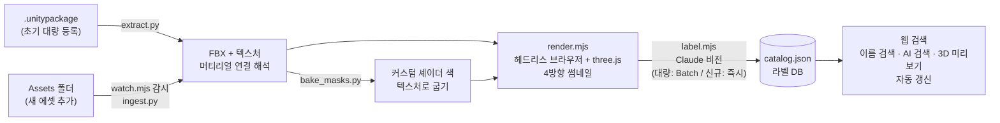

# AI 3D 에셋 검색

3D 모델 파일(FBX)을 열어보지 않아도, **"중세풍 붉은 상의"** 같은 자연어로 팀의 에셋을 찾을 수 있게 해 주는 도구입니다.
Claude 비전이 각 에셋을 렌더링한 이미지를 보고 라벨(분류, 색, 재질, 스타일, 착용 부위, 동의어)을 붙이고, 검색은 그 라벨을 대상으로 합니다.

**에셋 폴더에 FBX를 넣기만 하면** 1분 안에 썸네일과 라벨이 만들어져 검색에 나타납니다.

| 질문 | 파일명 검색 | AI 검색 |
|---|---|---|
| 중세풍 붉은 상의 | 0건 | 붉은 상의를 입은 중세 평민 캐릭터 |
| `ToyObject_180` 은 뭐지? | 이름만으로는 알 수 없음 | "주황색 C자 링 블록" (장난감, 플라스틱) |

<!-- RESULTS -->

## 만들게 된 이유

- 게임을 만들다 보면 에셋 이름을 대충 짓게 되고(`ToyObject_180`, `Mesh_02`), 잘 지어도 이름 하나에 색, 재질, 시대까지 다 담기는 어렵습니다.
- FBX는 3D 프로그램이나 유니티로 열어봐야 무엇인지 알 수 있어서, **기획팀이 직접 에셋을 찾기 어렵습니다.**
- 그래서 "이름"이 아니라 "생김새"로 찾을 수 있게, 생김새를 AI가 글로 적어 두도록 했습니다.

## 동작 방식



1. **추출**: `.unitypackage`(tar.gz)를 직접 읽어 FBX와 텍스처를 꺼냅니다. 유니티를 실행하지 않습니다. FBX → 프리팹 → 머티리얼(.mat) → 텍스처(`_MainTex`)로 이어지는 GUID 참조를 따라가서 어떤 텍스처가 어떤 메시에 쓰이는지 찾습니다.
2. **썸네일**: 헤드리스 Edge에서 three.js로 FBX를 렌더링합니다. AI용으로 앞/뒤/옆/위 4방향을 한 장에, 화면용으로 1장을 만듭니다.
3. **라벨링**: 4방향 이미지와 메타데이터(폴리곤 수, 스태틱/스켈레탈 메시, 머티리얼 이름)를 Claude에 보내고, 정해진 JSON 스키마(structured outputs)로 라벨을 받습니다.
4. **검색**
   - **이름 검색**: 파일명, 경로, 라벨 키워드에 대한 즉시 필터입니다. 무료입니다.
   - **AI 검색 (2단계)**
     1. Claude가 질문을 검색 조건(필수/가산 조건, 동의어 확장)으로 바꾸고 로컬에서 매칭해 **1차 후보 최대 100개**를 바로 보여줍니다.
     2. 이어서 Claude가 **에셋 목록 전체(라벨 요약)**를 보고 직접 골라 **가장 잘 맞음 / 관련 있음**으로 나누고 이유를 한 줄씩 붙입니다. 키워드가 겹치지 않는 "귀여운 느낌" 같은 질문도 여기서 잡힙니다. 목록은 프롬프트 캐시에 올려 질문마다 다시 과금되지 않게 합니다.
     3. 고르지 않은 1차 후보는 **더보기**에 접어 둡니다.
   - 한국어, 영어, 섞어 쓴 질문 모두 됩니다. 라벨에 한국어 설명과 영어 키워드가 함께 있습니다.
   - 분류, 팩, 스태틱/스켈레탈 메시로 거를 수 있고, 결과를 누르면 3D로 돌려보며 유니티 프로젝트 경로를 복사할 수 있습니다.
5. **자동 반영**: 감시 폴더에 새 FBX가 들어오면 그 파일만 1~4를 거쳐 화면에 나타납니다. 아래 [새 에셋 자동 반영](#새-에셋-자동-반영)을 참고하세요.

## 구현하면서 해결한 문제

**커스텀 셰이더 때문에 의상이 하얗게 렌더링됨**
일부 팩(Polytope 중세 캐릭터)은 마스크 텍스처의 영역마다 머티리얼에 지정된 색(천1, 가죽2, 금속1 …)을 곱하는 Amplify 셰이더를 씁니다. three.js는 이 셰이더를 모르기 때문에 색이 빠집니다.
→ `bake_masks.py`가 셰이더 소스에서 합성 규칙(어느 마스크의 어느 채널 → 어느 색 속성)을 파싱하고, 같은 계산을 numpy로 재현해 색이 입혀진 텍스처를 굽습니다. 이 단계가 없으면 "붉은 상의"는 찾을 수 없습니다.

**머티리얼 연결이 없는 팩**
프리팹이나 머티리얼 참조가 없는 팩은 FBX 근처 폴더의 Base Color 텍스처를 이름 유사도로 골라 씁니다.

**검색 정확도**
"상의"를 찾는데 장화가 섞여 나오는 문제가 있었습니다. 라벨의 착용 부위가 질문과 다른 장비는 제외하도록 했습니다.

**여러 프로세스가 같은 DB를 동시에 씀**
웹 서버, 폴더 감시, 썸네일 렌더러, 배치 수거가 `catalog.json`을 함께 읽고 씁니다. 각자 처음에 읽은 내용을 그대로 저장하면 서로의 변경을 덮어씁니다.
→ 저장 직전에 최신 파일을 다시 읽어 **자기가 바꾼 항목만** 합치고, 임시 파일에 쓴 뒤 바꿔치기(원자적 교체)해서 읽는 쪽이 반쯤 쓰인 파일을 보지 않게 했습니다.

**배치가 도는 동안 들어온 새 에셋**
배치가 몇 시간 걸릴 수 있는데, 그동안 새 에셋까지 기다리게 하면 "넣으면 바로 뜬다"가 깨집니다. 배치에 이미 들어간 에셋만 제외하고 새 에셋은 즉시 라벨링합니다.

## 비용

모델: Claude Opus 5.5. 아래는 실제 호출에서 측정한 값입니다.

| 작업 | 비용 | 비고 |
|---|---|---|
| 에셋 라벨링 (일반 호출) | 개당 약 $0.024 | 입력 약 4,300토큰(이미지 약 1,400) + 출력 약 350토큰 |
| 에셋 라벨링 (Batch API) | 개당 약 $0.012 | 50% 할인. 초기 대량 등록에 사용 |
| AI 검색 | 질문당 약 $0.03 | 1차 조건 변환 약 $0.013 + 2차 선별 약 $0.015 (목록 캐시) |
| 이름 검색, 감시, 추출, 렌더링 | 무료 | 모두 로컬에서 실행 |

<!-- COST -->

- 라벨링은 실시간일 필요가 없어서 **Batch API**(50% 할인)로 처리합니다.
- 처음 10개는 일반 호출로 품질과 비용을 확인한 뒤, 나머지를 배치로 돌렸습니다.
- 한 번 라벨링한 에셋은 다시 호출하지 않습니다.
- 입력 토큰은 이미지보다 지시문과 응답 스키마 쪽이 더 커서, 이미지 해상도를 낮춰도 절감 폭이 작습니다(토큰 계산으로 확인).

## 실행 방법

요구 사항: Node.js 22 이상, Python 3.10 이상, Edge 또는 Chrome, [Anthropic API 키](https://console.anthropic.com)

```bash
npm install
pip install pillow numpy

# .env 파일에 키 저장 (커밋되지 않음)
echo ANTHROPIC_API_KEY=sk-ant-... > .env

# 1) 추출 — 에셋 폴더 지정, 사용할 팩은 tools/extract.py 의 PACKS 에서 설정
set UNITY_ASSET_ROOT=D:\유니티 에셋
python tools/extract.py
python tools/bake_masks.py        # 마스크 셰이더 팩이 있을 때

# 2) 썸네일
node tools/render.mjs

# 3) 라벨링
node tools/label.mjs --test 10    # 일반 호출로 10개, 결과와 비용 확인
node tools/label.mjs --batch      # 나머지를 Batch API 로 제출
node tools/label.mjs --collect    # 결과 받기 (끝날 때까지 다시 실행)

# 4) 검색 웹
npm start                         # http://localhost:8080

# 5) 새 에셋 자동 반영
npm run watch                     # incoming/ (또는 WATCH_DIR) 감시
npm run update                    # 감시 없이 한 번만 반영
```

## 새 에셋 자동 반영

`npm run watch`를 켜 두면, 감시 폴더(유니티 프로젝트의 `Assets/` 등)에 FBX를 넣는 것만으로 1분 안에 검색에 나타납니다.

1. 파일 변화가 멈추고 3초 뒤, DB에 없거나 **내용이 바뀐** FBX만 골라냅니다. 지워진 FBX는 DB에서도 뺍니다.
2. `.meta` → `.mat` → 텍스처 연결을 따라가 썸네일을 만들고, 그 에셋만 Claude로 라벨링합니다.
3. 화면은 4초마다 상태를 확인해, 새 에셋이 들어오면 NEW 표시와 함께 맨 앞에 보여줍니다.

비용은 **새 에셋이 들어올 때만** 듭니다(개당 약 $0.024). 감시, 추출, 렌더링은 모두 로컬에서 돌아서 무료입니다.

| 안전장치 | 기본값 | 동작 |
|---|---|---|
| 한 번에 들어온 개수 | 50개 (`AUTO_MAX`) | 넘으면 자동 라벨링하지 않고, 화면에 "Batch로 처리" 버튼을 띄웁니다 (50% 할인) |
| 하루 자동 라벨링 비용 | $1 (`DAILY_CAP_USD`) | 넘으면 멈추고 다음 날 이어서 합니다 |
| 같은 파일 | 해시 비교 | 내용이 같으면 다시 호출하지 않습니다 |

## 폴더 구조

```
tools/
  extract.py       .unitypackage → FBX/텍스처 추출, 머티리얼 연결 해석
  bake_masks.py    마스크 합성 셰이더 → 텍스처 굽기
  render.mjs       헤드리스 브라우저로 썸네일 렌더링 (render.html)
  label.mjs        Claude 라벨링 (일반 / Batch / 자동)
  ingest.py        감시 폴더 → 새로 생기거나 바뀐 FBX 만 DB 에 추가
  watch.mjs        폴더 감시 → ingest → render → label 자동 실행
web/
  index.html, app.js, style.css   검색 화면
  search.mjs       AI 질의 해석 + 로컬 매칭 (서버·브라우저 공용)
  fbx-materials.js 머티리얼 적용 (썸네일 렌더러·3D 뷰어 공용)
server.mjs         검색 API + 정적 파일 서버
```

`library/`(추출한 에셋), `thumbs/`(렌더 이미지), `data/`(라벨 DB)는 유료 에셋에서 나온 데이터라 저장소에 포함하지 않았습니다.

## 한계와 확장

- 여러 조각이 떨어져 있는 모델(장갑 한 쌍 등)이나 여러 에셋이 한 FBX에 든 경우는 썸네일이 작거나 텍스처가 맞지 않을 수 있습니다.
- 초기 데이터는 `.unitypackage`에서 추출했고, 이후 추가분은 `Assets/` 같은 풀린 폴더를 감시해서 받습니다. 두 경로 모두 같은 `.mat`/`.meta` 해석 로직을 씁니다.
- 수천 개 이상이면 JSON 대신 SQLite 전문검색으로, 분위기 같은 애매한 검색이 많으면 임베딩 검색으로 확장할 수 있습니다.
- 같은 방식으로 **애니메이션 클립**(모션을 렌더링해 "칼 휘두르기"로 검색), **사운드**(오디오 설명 생성), **텍스처/머티리얼**(재질 검색)로 넓힐 수 있습니다.
